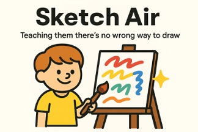

<h1 align="center">✨ Sketch Air</h1>

  

  <b>Sketch Air</b> lets you draw in mid-air using just your hand and a webcam. 
  Your sketches are then transformed into <b>beautiful artwork by AI</b>.

---

## Continuous integration

GitHub Actions runs **Build and typecheck** on pushes to `development` and on
non-draft pull requests when opened, reopened, updated, or marked ready for review.
Draft pull request jobs are skipped. Using Node.js 22, it installs the locked dependencies
with `npm ci`, runs `npm run typecheck`, and builds with `npm run build`.
No API key is needed. These checks validate source types and bundling; they do
not test webcam, speech recognition, CDN availability, or live Gemini requests.

The MediaPipe CDN import uses declarations from the matching `0.10.0` development
dependency. Keep both versions aligned when upgrading hand tracking.

To make this check mandatory before merging, select **Build and typecheck** in
the target branch's GitHub ruleset or branch protection settings after its first run.

## 🚀 Quick Start

<ol>
  <li>
    <b>Install dependencies</b>
     
    <pre><code>npm install</code></pre>
  </li>
  <li>
    <b>Start the app</b>
     
    <pre><code>npm run dev</code></pre>
  </li>
  <li>
    <b>Open in your browser</b>
     
    Visit <a href="http://localhost:3000">http://localhost:3000</a>
  </li>
</ol>

  Built with ❤️ for <b>AI Hackathon</b>

